# Portfolio for WIL Assignment

### PRP370 Project Presentation 3

This portfolio showcases my work throughout the Agile development process, including the team charter, user stories, product and sprint backlogs, and logbooks. It highlights how I planned, organised and tracked tasks while working with my team, as well as the lessons I learned throughout the project.

Table of Contents

1. [Agile Team Charter](#1-agile-team-charter)
2. [User Stories and Tasks](#2-user-stories-and-tasks)
3. [Trello](#3-trello)
4. [Product and Sprint Backlog](#4-product-and-sprint-backlog)
5. [Agile Logbook](#5-agile-logbook)

---

## 1. Agile Team Charter

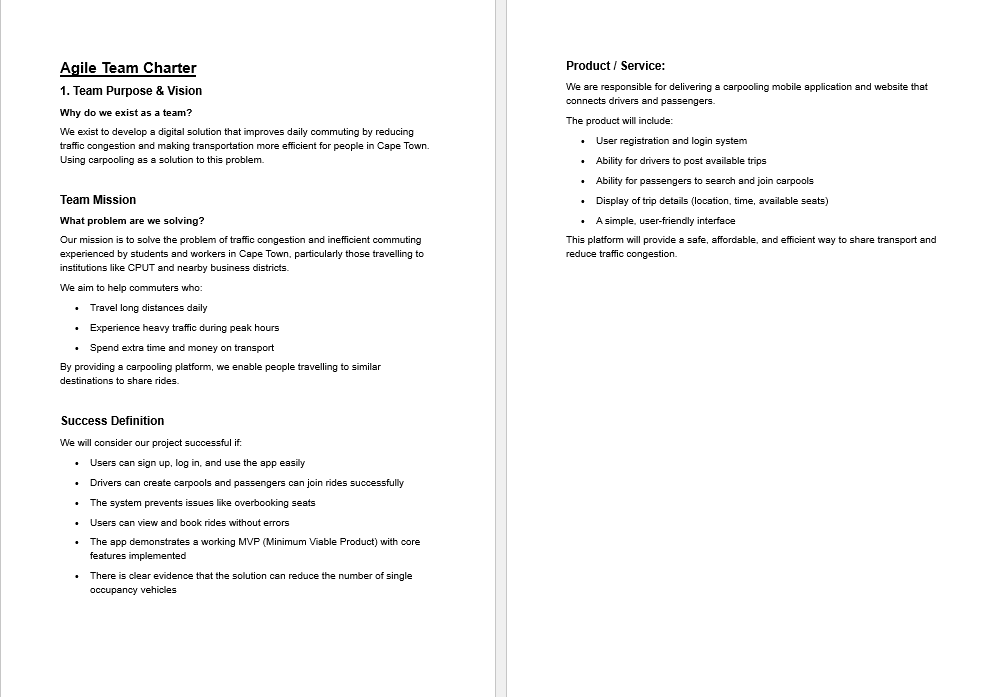

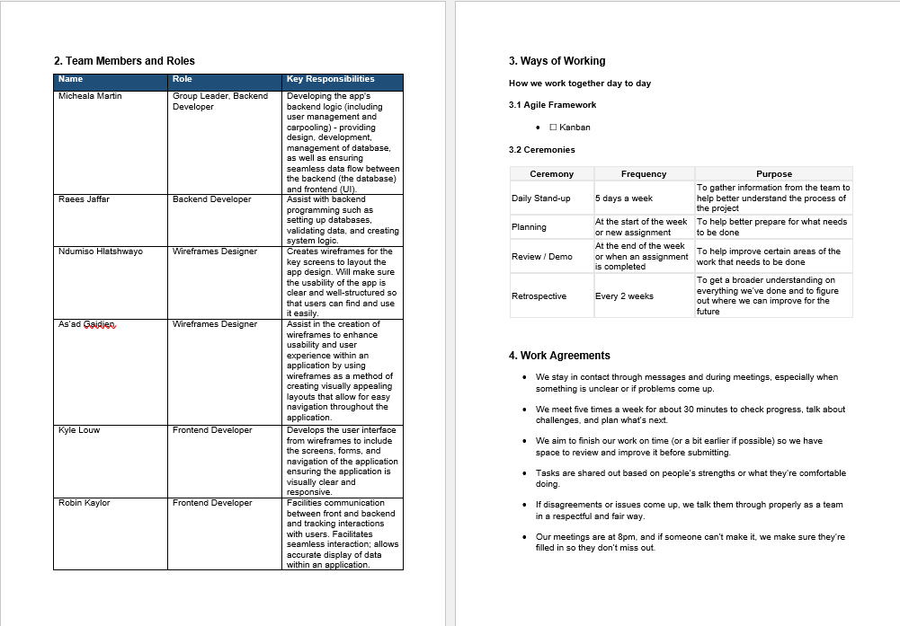

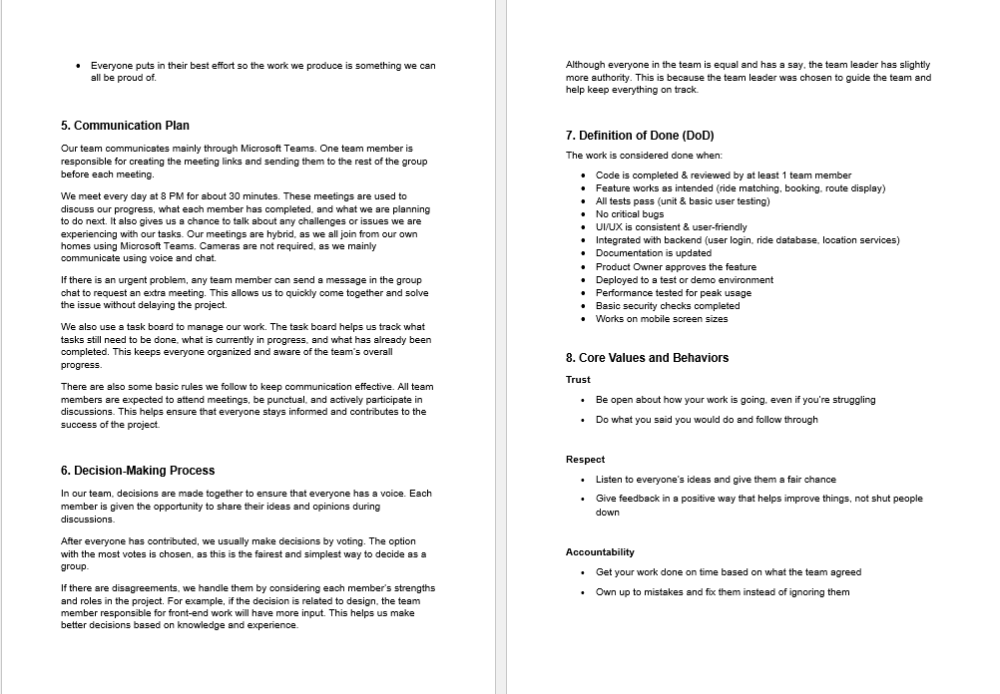

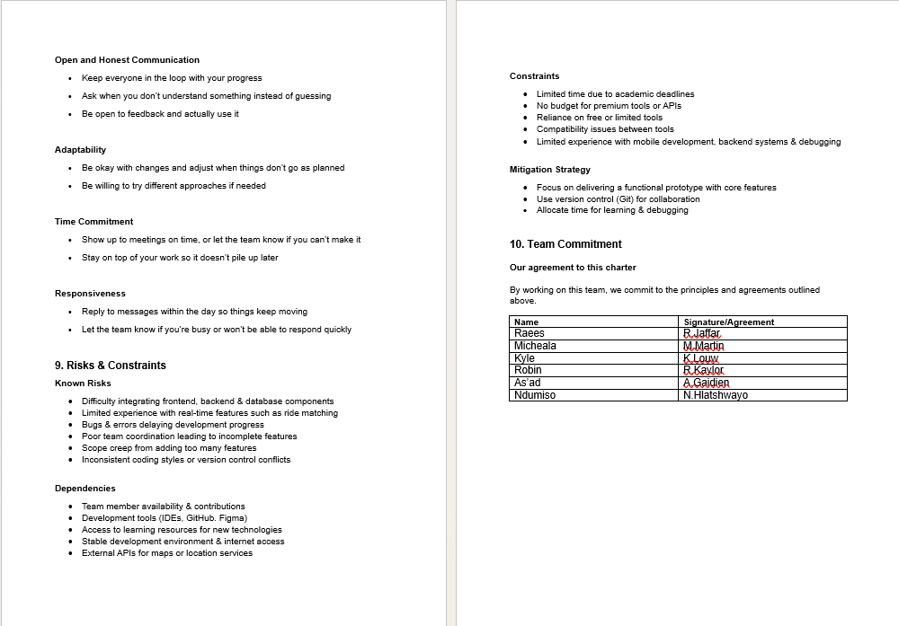

[View the complete Agile Team Charter](evidence/agile-team-charter.pdf)

### Reflection

Creating an Agile Team Charter has given me a better understanding of teamwork and the importance of taking responsibility. Throughout the entrepreneurship programme, the team charter acted as a guideline for what the project should entail, how the team should work together and what was expected from each member. By working according to the team charter, I learned to take responsibility for my role and the quality of the work I contribute to the team. This experience has given me a glimpse into what working in a professional environment could be like, particularly when collaborating with others and being accountable for my responsibilities. It has helped me understand that successful teamwork requires commitment, accountability and cooperation from every team member.

---

## 2. User Stories and Tasks

This section presents the user stories created for the RideConnect Mobile App. The images below provide a preview of the user stories for the different user roles. A link is also provided to access the complete user stories document.

### Rider User Stories

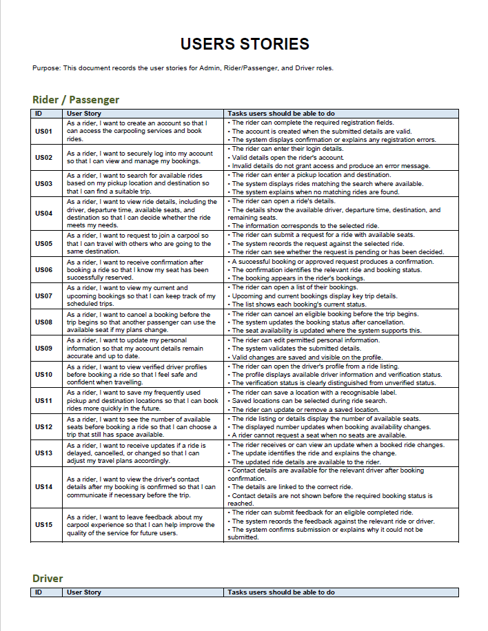

### Driver User Stories

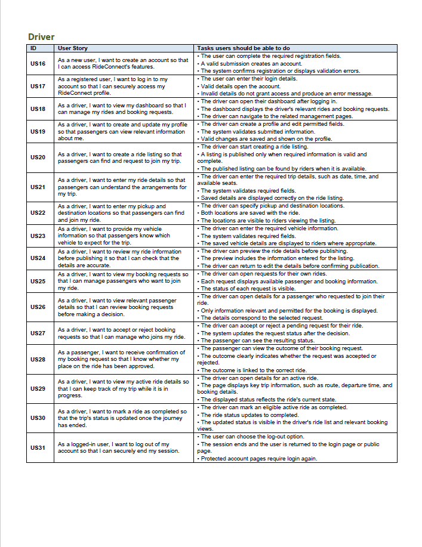

### Admin User Stories

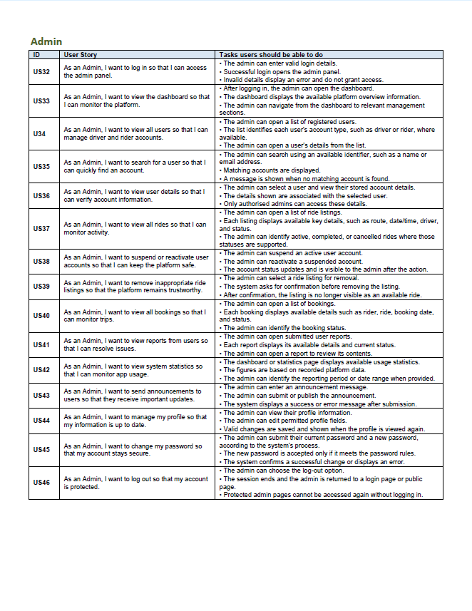

[View the Complete User Stories Document](evidence/RideConnect-user-stories.pdf)

### Reflection

The user stories were helpful in planning the navigation for all the users. At the beginning of the project, they acted as a guideline for what I wanted each user to be able to do with the app. However, when reviewing the user stories, I realised that I had mainly focused on the rider and driver and had overlooked the admin section. The user stories provided a good foundation because, while working with my team and designing the prototype, I remembered the needs of the rider and driver, and most of the tasks matched the features I designed. I only realised that I had not considered the admin section when I reviewed the user stories again. From this, I learned the importance of regularly referring back to the user stories while designing a prototype to ensure that the needs of all users are considered in future projects.

---

## 3. Trello

The Trello board contains many tasks and cards, so I have created several lists in order to show the entire trello board.

#### This is not how it acually looks like.

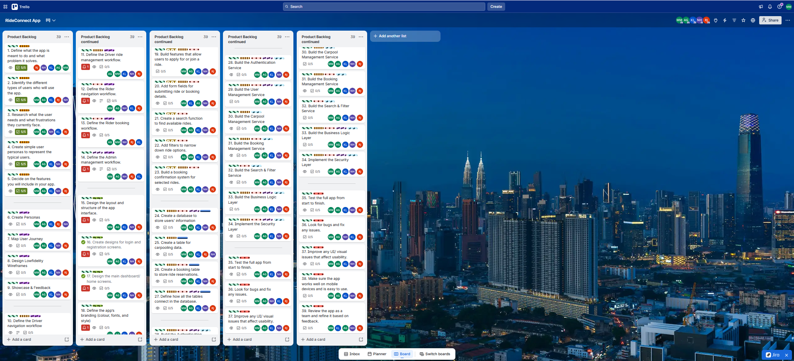

[View the complete Trello Board](https://trello.com/b/BpT1NslS)

### Reflection

Creating and using a Trello board was different from how I had approached projects in the past. Previously, I would receive the instructions for an assignment and focus on completing the work without using a tool to organise and monitor my progress. However, working in a group required a more structured approach to managing the project's tasks and deadlines. By using Trello, I was able to keep track of the tasks involved, monitor the project's progress and understand where I was within the overall process. The board acted as a schedule that helped me organise my work and remain aware of what needed to be completed. As a result, this experience has changed how I would approach future projects, as I now understand the value of using project management tools to organise tasks, manage time and monitor progress, particularly in a professional working environment.

---

## 4. Product and Sprint Backlogs

This section presents the product and sprint backlogs for the RideConnect Mobile App. Each image provides a visual overview of the tasks organised for the relevant sprint. A link below each image allows the reader to view the corresponding Trello board for more details.

### Sprint 1 Backlog

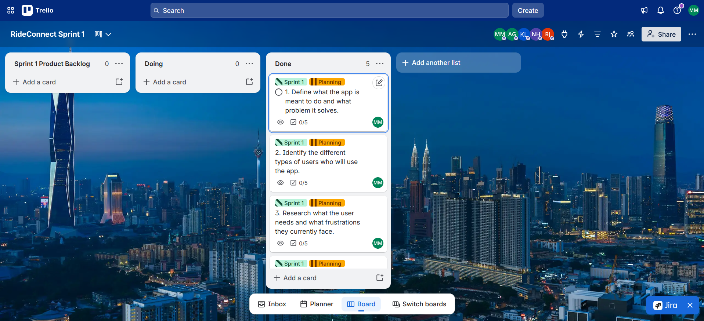

[View Sprint 1 Backlog on Trello](https://trello.com/b/AFQp5byc)

---

### Sprint 2 Backlog

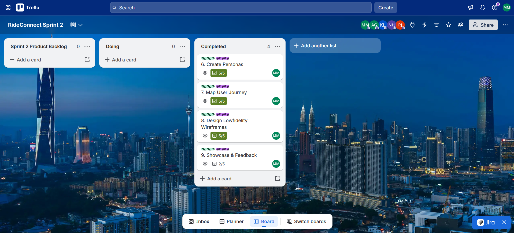

[View Sprint 2 Backlog on Trello](https://trello.com/b/AFQp5byc)

---

### Sprint 3 Backlog

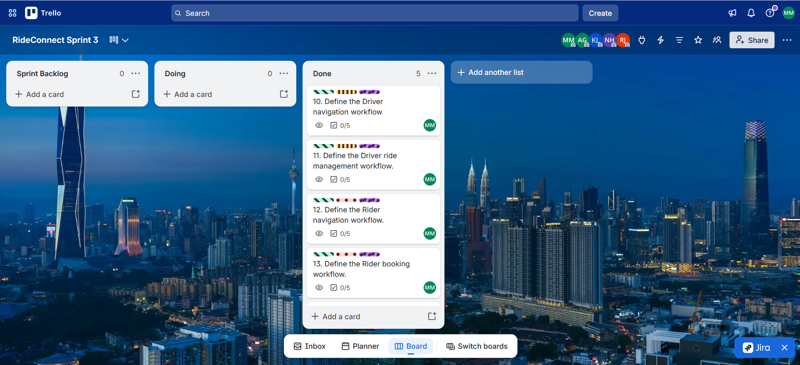

[View Sprint 3 Backlog on Trello](https://trello.com/b/1jregnhD)

---

### Sprint 4 Backlog

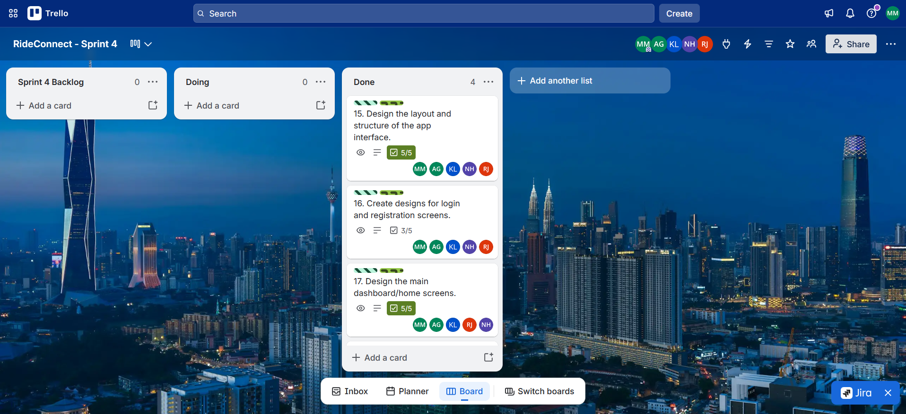

[View Sprint 4 Backlog on Trello](https://trello.com/b/hwYaQYf8)

---

### Sprint 5 Backlog

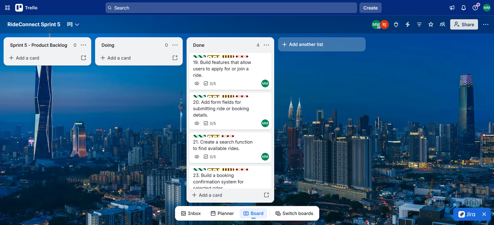

[View Sprint 5 Backlog on Trello](https://trello.com/b/TAAdbR1I)

---

### Sprint 6 Backlog

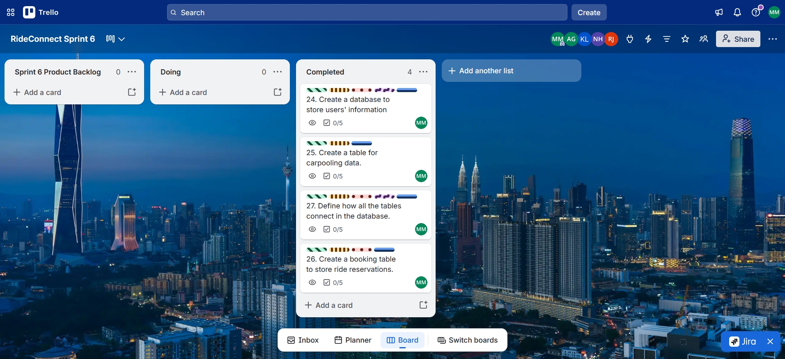

[View Sprint 6 Backlog on Trello](https://trello.com/b/IGZLjIHC)

---

### Sprint 7 Backlog

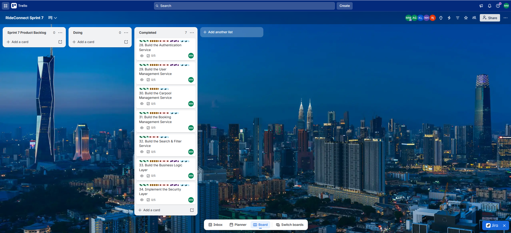

[View Sprint 7 Backlog on Trello](https://trello.com/b/te0zD0ZS)

---

### Reflection

When I first encountered the product and sprint backlogs, I did not fully understand their purpose because I already had access to the complete Trello board. I initially questioned why I needed to organise the work further when all the project tasks were already available. However, learning to prioritise the project tasks and divide them into sprints helped me understand the value of breaking a larger project into smaller, manageable stages. By focusing on the tasks assigned to each sprint, I was able to approach the workload in a more organised manner instead of feeling pressured to complete too many tasks within a single week. This gave me a greater sense of control over my work and made it easier to track my progress. Through this experience, I learned that planning work in stages can make a project more manageable and has helped me develop a more structured approach to completing tasks.

## 5. Agile Logbook

#### Logbook for the 14-17th July 2026

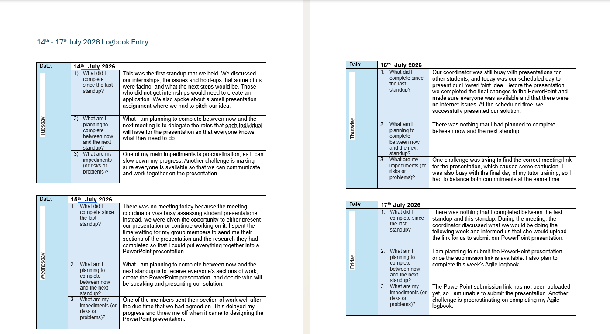

---

#### Logbook for the 21-24th July 2026

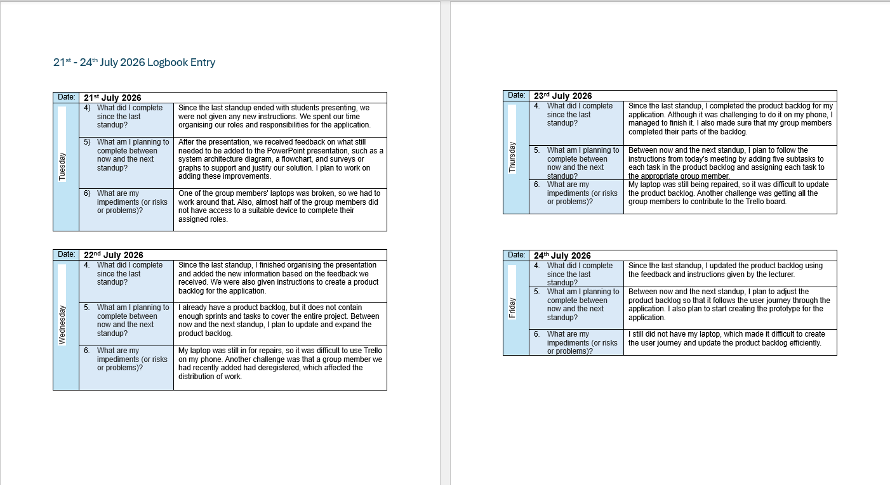

---

#### Logbook for the 28th-31st July 2026

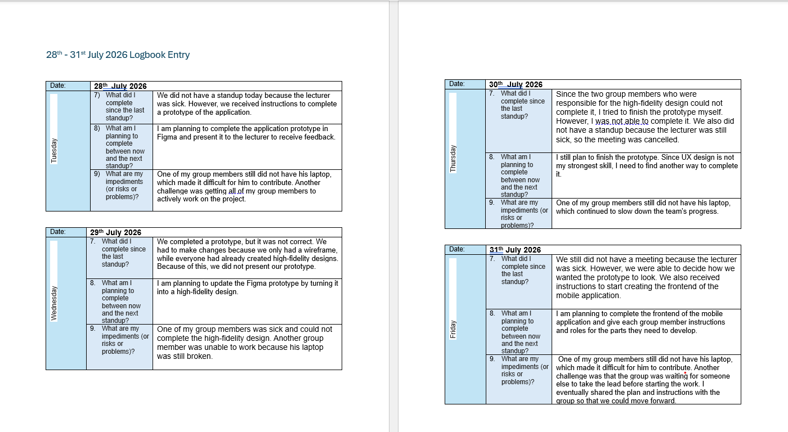

---

#### Logbook for the 4th-7th August 2026

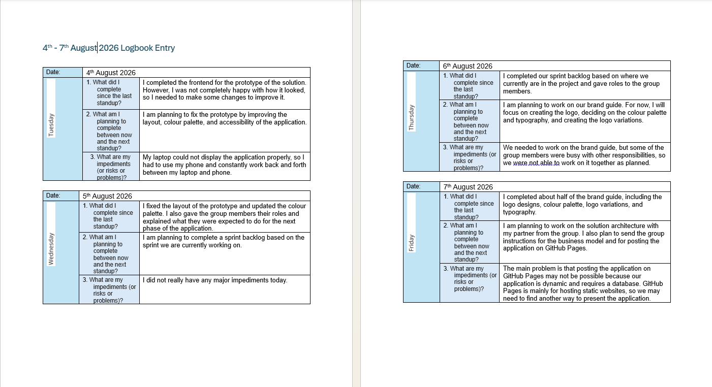

### Logbooks Link

[View agile logbook entries](evidence/agile-logbooks.pdf)

### Reflection

Using the Agile logbook was different from what I initially expected. At first, I only recorded what I had done because it was a requirement of the programme. However, by the third entry, I began answering the reflection questions on a separate piece of paper so that I would not forget important details and could keep track of my progress. The logbook also provided a space for me to record the challenges I experienced throughout the project, including delays caused by team members and my laptop breaking down. Recording these experiences allowed me to document not only the work I completed but also the difficulties I encountered along the way. Looking back at my logbook at the end of the entrepreneurship programme, I can recognise the progress I made from the beginning to the end of the project and how my learning developed over time. This experience has shown me that a logbook is more than a record of completed tasks; it is also a way to reflect on challenges, recognise personal development and identify areas for improvement.
